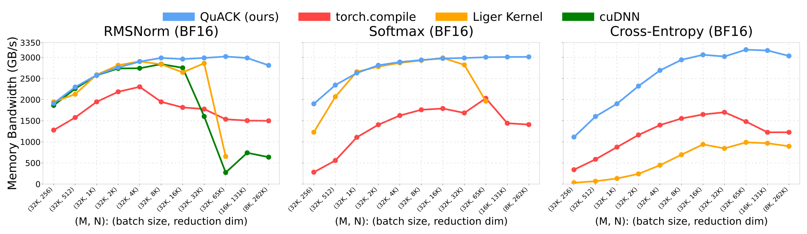

# 🦆 QuACK: A Quirky Assortment of CuTe Kernels 🦆

Kernels are written in the [CuTe-DSL](https://docs.nvidia.com/cutlass/latest/media/docs/pythonDSL/cute_dsl_general/dsl_introduction.html).

## Installation

``` bash
# For CUDA 12.9:
pip install quack-kernels

# For CUDA 13.x:
pip install 'quack-kernels[cu13]' --extra-index-url https://download.pytorch.org/whl/cu130

# Do not use uv for CUDA 13.x installs yet: it can race/install
# nvidia-cutlass-dsl[cu13] in the wrong order (NVIDIA/cutlass#3259):
# https://github.com/NVIDIA/cutlass/issues/3259

# Optional: install NVIDIA matmul heuristics for better untuned GEMM configs
pip install 'quack-kernels[heuristics]'

# Optional: JAX bindings (pulls in jax and jax-tvm-ffi)
pip install 'quack-kernels[jax]'
```

## Requirements

- H100, B200/B300, or RTX 50 GPU
- CUDA toolkit 12.9+
- Python 3.12

## Kernels 🐥

- 🦆 RMSNorm forward + backward
- 🦆 Softmax forward + backward
- 🦆 Cross entropy forward + backward
- 🦆 Layernorm forward + backward
- 🦆 Hopper gemm + epilogue
- 🦆 Blackwell gemm + epilogue
- 🦆 Blackwell GeForce gemm + epilogue

## Usage

```
from quack import rmsnorm, softmax, cross_entropy
```

JAX bindings are also available for some kernels (see [docs/jax.md](docs/jax.md)):

```
from quack.softmax_jax import softmax
```

## Documentations

- [JAX interface](docs/jax.md) — optional `jax` + `jax-tvm-ffi` bindings, see `quack/softmax_jax.py` for an example.

[2025-07-10] We have a comprehensive
[blogpost](media/2025-07-10-membound-sol.md) on how to get memory-bound kernels
to speed-of-light, right in the comfort of Python thanks to the [CuTe-DSL](https://docs.nvidia.com/cutlass/media/docs/pythonDSL/cute_dsl_general/dsl_introduction.html).

## Performance

<div align="center">
<figure>
  
</figure>
</div>

See our [blogpost](media/2025-07-10-membound-sol.md) for the details.

## Development

To set up the development environment:

```bash
pip install -e '.[dev]'
pre-commit install

# For CUDA 13.x:
pip install 'quack-kernels[dev,cu13]' --extra-index-url https://download.pytorch.org/whl/cu130

# Do not use uv for CUDA 13.x installs yet; use pip instead.
# See https://github.com/NVIDIA/cutlass/issues/3259
```

## Conda development environment (CUDA 12.9)

Create a clean environment rather than cloning an existing environment, which may bring in
incompatible CUDA or CUTLASS packages:

```bash
conda create --name zh_quack_env312 python=3.12 pip -y
conda activate zh_quack_env312
python -m pip install --upgrade pip
```

From the repository root, install the CUDA 12.9 build of PyTorch first. Using the CUDA-specific
index prevents pip from selecting a CUDA 13 build that requires a newer driver:

```bash
python -m pip install "torch==2.13.0" \
  --index-url https://download.pytorch.org/whl/cu129
python -m pip install \
  "cuda-python==12.9.4" \
  "cuda-bindings==12.9.4"
```

Install QuACK in editable mode so changes to this checkout are used by new Python processes:

```bash
python -m pip install -e '.[dev]'
```

Validate the environment and editable installation:

```bash
python -m pip check
python -c "import quack, torch; print(torch.__version__, torch.version.cuda); print(torch.cuda.is_available()); print(quack.__file__)"
```

Finally, run a small numerical GPU check:

```bash
python - <<'PY'
import torch

from quack.softmax import softmax

x = torch.randn(2, 1024, device="cuda", dtype=torch.bfloat16)
y = softmax(x)
torch.testing.assert_close(y, torch.softmax(x, dim=-1), atol=1e-2, rtol=1e-2)
print("QuACK works:", y.shape, torch.cuda.get_device_name())
PY
```

## Bitmask token exchange on Hopper

`run/hopper_stream_gather_table_gemm.py` supports an opt-in, one-time variable-size
initial exchange. Add these options to a single-node `torchrun` command using
`--initial-token-exchange --multi-buffer-gather --proxy-mode thread`:

```bash
--bitmask-token-routing --token-route-probability 0.25 --local-routes-per-token 2
```

Without `--bitmask-token-routing`, the existing equal-chunk exchange is unchanged.
The new mode requires 2–8 GPUs, `--num-input-buffers` equal to the number of GPUs,
and a positive `--source-tokens` (which need not be divisible by the GPU count).
Rebuild the thread proxy with CUDA 12.9 or newer before running:

```bash
cmake -S run/cpu_proxy -B run/cpu_proxy/build
cmake --build run/cpu_proxy/build -j
```

Each rank generates a reproducible `uint8` router vector on its GPU, with one byte
per source token. On source rank `s`, bit `j` selects `(s + j + 1) % world_size`;
only the low `world_size` bits are used, including the bit selecting the local
GPU. Each bit is independently set with probability `--token-route-probability`
(default 0.25). Tokens may therefore have zero or multiple destinations.

Ranks exchange counts before allocating one input buffer per source. Selected
source rows are copied in increasing token-index order with one
`cudaMemcpyBatchAsync` call per nonempty destination. The exchange happens once,
before warmup, and is excluded from GEMM timing.

In this mode, `--tokens-per-buffer` and `--routes-per-buffer` do not determine
allocation or work sizes. A buffer receiving `T` tokens has
`T * --local-routes-per-token` local expert routes (default multiplier 2), with at
least one route for every received token. Per-expert quotas remain near-even.
Without `--routing-with-replacement`, the multiplier cannot exceed the number of
local experts. Empty pairs have zero routes; completely idle ranks skip GEMMs
but still participate in result-return completion barriers.

Both `--return-token-results` and `--return-token-results-per-group` support the
variable sizes, with their existing prerequisite flags. A source allocates its
receive buffer for computing rank `d` using the number of tokens it sent to `d`.
The return preserves packed token order and the selected output layout; it does
not scatter into or reduce across the original source-token tensor. The routing
plan retains the selected source indices (`inputs.routing_plan.indices`), also
exposed as `ReturnExchange.source_token_indices`. Per-group returns use each
peer's own byte count and tile offset. The reported GEMM throughput still excludes
the final wait for return DMA and the rank barrier, although concurrent DMA can
influence GEMM performance.

Add `--final-combine` together with `--bitmask-token-routing --return-token-results`
to reduce the returned results on each source GPU after every iteration. A CuTe
kernel reads the packed buffers (including N-tile-major layout), sums contributions
in FP32, and writes a contiguous `[source_tokens, hidden]` tensor in the received
dtype, available as `ReturnExchange.combined_output`. Tokens sent nowhere receive
zeros. This is an unweighted sum of the already locally combined expert outputs.
Add `--final-combine-ctas 16` to launch exactly 16 persistent CTAs, with 256 threads
per CTA. Each CTA processes 256-column chunks in a grid-stride loop. The default,
`--final-combine-ctas 0`, launches `source_tokens * ceil(hidden / 256)` CTAs.
The CTA count limits the number of blocks, but does not guarantee one CTA per SM
or reserve particular SMs. This option requires `--final-combine`.
The combine runs after return-copy completion and finishes before receive buffers
are reused; its execution is excluded from both reported throughput timings.
CUDA events bracket the final-combine launch after return-copy completion. Each
rank reports the mean time per timing sample and the median of those means,
excluding warmup. These event intervals can include GPU idle gaps during host
enqueue and are not a profiler measurement of kernel-only duration.
Without this flag, only the separate packed receive buffers are produced.

CPU metadata checks and a Hopper numerical integration regression:

```bash
python -m unittest run.test_token_routing run.test_bitmask_routing
python -m unittest run.test_final_combine  # Requires CUDA and CuTe DSL
torchrun --standalone --nnodes=1 --nproc-per-node=4 run/test_bitmask_token_exchange.py
```

The integration regression includes legacy exchange, unequal counts, sparse and
empty routing, full replication, whole-buffer returns, and one/two-tile return
groups. It validates dispatched token values, returned bytes, and GEMM outputs.
