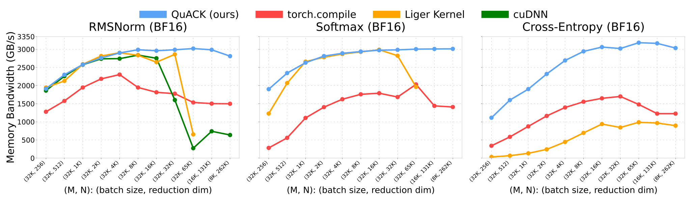

# 🦆 QuACK: A Quirky Assortment of CuTe Kernels 🦆

Kernels are written in the [CuTe-DSL](https://docs.nvidia.com/cutlass/latest/media/docs/pythonDSL/cute_dsl_general/dsl_introduction.html).

## Installation

``` bash
# For CUDA 12.9:
pip install quack-kernels

# For CUDA 13.x:
pip install 'quack-kernels[cu13]' --extra-index-url https://download.pytorch.org/whl/cu130

# Do not use uv for CUDA 13.x installs yet: it can race/install
# nvidia-cutlass-dsl[cu13] in the wrong order (NVIDIA/cutlass#3259):
# https://github.com/NVIDIA/cutlass/issues/3259

# Optional: install NVIDIA matmul heuristics for better untuned GEMM configs
pip install 'quack-kernels[heuristics]'

# Optional: JAX bindings (pulls in jax and jax-tvm-ffi)
pip install 'quack-kernels[jax]'
```

## Requirements

- H100, B200/B300, or RTX 50 GPU
- CUDA toolkit 12.9+
- Python 3.12

## Kernels 🐥

- 🦆 RMSNorm forward + backward
- 🦆 Softmax forward + backward
- 🦆 Cross entropy forward + backward
- 🦆 Layernorm forward + backward
- 🦆 Hopper gemm + epilogue
- 🦆 Blackwell gemm + epilogue
- 🦆 Blackwell GeForce gemm + epilogue

## Usage

```
from quack import rmsnorm, softmax, cross_entropy
```

JAX bindings are also available for some kernels (see [docs/jax.md](docs/jax.md)):

```
from quack.softmax_jax import softmax
```

## Documentations

- [JAX interface](docs/jax.md) — optional `jax` + `jax-tvm-ffi` bindings, see `quack/softmax_jax.py` for an example.

[2025-07-10] We have a comprehensive
[blogpost](media/2025-07-10-membound-sol.md) on how to get memory-bound kernels
to speed-of-light, right in the comfort of Python thanks to the [CuTe-DSL](https://docs.nvidia.com/cutlass/media/docs/pythonDSL/cute_dsl_general/dsl_introduction.html).

## Performance

<div align="center">
<figure>
  
</figure>
</div>

See our [blogpost](media/2025-07-10-membound-sol.md) for the details.

## Development

To set up the development environment:

```bash
pip install -e '.[dev]'
pre-commit install

# For CUDA 13.x:
pip install 'quack-kernels[dev,cu13]' --extra-index-url https://download.pytorch.org/whl/cu130

# Do not use uv for CUDA 13.x installs yet; use pip instead.
# See https://github.com/NVIDIA/cutlass/issues/3259
```

## Conda development environment (CUDA 12.9)

Create a clean environment rather than cloning an existing environment, which may bring in
incompatible CUDA or CUTLASS packages:

```bash
conda create --name zh_quack_env312 python=3.12 pip -y
conda activate zh_quack_env312
python -m pip install --upgrade pip
```

From the repository root, install the CUDA 12.9 build of PyTorch first. Using the CUDA-specific
index prevents pip from selecting a CUDA 13 build that requires a newer driver:

```bash
python -m pip install "torch==2.13.0" \
  --index-url https://download.pytorch.org/whl/cu129
python -m pip install \
  "cuda-python==12.9.4" \
  "cuda-bindings==12.9.4"
```

Install QuACK in editable mode so changes to this checkout are used by new Python processes:

```bash
python -m pip install -e '.[dev]'
```

Validate the environment and editable installation:

```bash
python -m pip check
python -c "import quack, torch; print(torch.__version__, torch.version.cuda); print(torch.cuda.is_available()); print(quack.__file__)"
```

Finally, run a small numerical GPU check:

```bash
python - <<'PY'
import torch

from quack.softmax import softmax

x = torch.randn(2, 1024, device="cuda", dtype=torch.bfloat16)
y = softmax(x)
torch.testing.assert_close(y, torch.softmax(x, dim=-1), atol=1e-2, rtol=1e-2)
print("QuACK works:", y.shape, torch.cuda.get_device_name())
PY
```

## Blackwell node development environment (CUDA 12.9)

The following setup was validated on a Linux x86_64 node with eight NVIDIA B300 GPUs
(compute capability 10.3), driver 590.48.01, Python 3.12, PyTorch 2.13.0+cu129,
and CUTLASS DSL 4.7.0. Run these commands on the remote Blackwell node.

Check the GPUs and CPU architecture:

```bash
nvidia-smi
uname -m
```

The `CUDA Version` shown by `nvidia-smi` describes the driver's CUDA support, not the
CUDA version installed in the Python environment. The validated node reports CUDA 13.1
there and runs this CUDA 12.9 environment successfully.

Initialize Conda for the current shell and create a clean environment. Adjust the Miniconda
path if necessary:

```bash
source ~/miniconda3/etc/profile.d/conda.sh
conda create --name zh_quack_blackwell312 python=3.12 pip -y
conda activate zh_quack_blackwell312
python -m pip install --upgrade pip
```

Install the CUDA 12.9 PyTorch build and matching CUDA Python bindings:

```bash
python -m pip install "torch==2.13.0" \
  --index-url https://download.pytorch.org/whl/cu129
python -m pip install \
  "cuda-python==12.9.4" \
  "cuda-bindings==12.9.4"
```

Install this repository checkout in editable mode, replacing the path below with its
location on the node. This installs the pinned CUTLASS DSL 4.7.0 dependency and uses source
changes in new Python processes:

```bash
cd /path/to/quack_for_communication_overlap
python -m pip install -e '.[dev]'
python -m pip check
```

Optionally enable the development Git hooks with `pre-commit install`.

Verify the package versions, source location, and GPU visibility:

```bash
python - <<'PY'
from importlib.metadata import version

import torch
import quack

assert torch.cuda.is_available(), "CUDA is unavailable"
print("PyTorch:", torch.__version__)
print("PyTorch CUDA:", torch.version.cuda)
print("CUTLASS DSL:", version("nvidia-cutlass-dsl"))
print("QuACK:", quack.__file__)
print("Visible GPUs:", torch.cuda.device_count())
print("GPU:", torch.cuda.get_device_name(0))
print("Compute capability:", torch.cuda.get_device_capability(0))
PY
```

Confirm that PyTorch reports CUDA `12.9` and that `quack.__file__` points into this checkout.
Then run a numerical GEMM check on GPU 0, comparing against an FP32 reference with a BF16
PyTorch baseline for tolerance:

```bash
CUDA_VISIBLE_DEVICES=0 python - <<'PY'
import math

import torch
from quack.gemm_interface import gemm

torch.manual_seed(0)
m, n, k = 512, 512, 512
a = torch.randn(m, k, device="cuda", dtype=torch.bfloat16) / math.sqrt(k)
b = torch.randn(k, n, device="cuda", dtype=torch.bfloat16) / math.sqrt(k)

with torch.inference_mode():
    out = gemm(a, b, tuned=False)
    reference = a.float() @ b.float()
    baseline = (a @ b).float()

baseline_error = (baseline - reference).abs().max().item()
torch.testing.assert_close(
    out.float(), reference,
    atol=max(1e-3, 2 * baseline_error),
    rtol=1e-2,
)

print("QuACK GEMM: PASS")
print("Max absolute error:", (out.float() - reference).abs().max().item())
PY
```

The first run compiles the kernel and takes longer. This check passed on the B300 node
with a maximum absolute error of approximately `4.88e-4`.

This validates basic Blackwell GEMM. The communication extensions below have a native
Blackwell implementation, but still require compilation, numerical validation, and
performance measurement on B300. The earlier basic-GEMM result does not validate them.

### Blackwell communication GEMM validation

The native SM100 kernel now accepts single-buffer/indexed and multi-buffer gather tables,
streamed table readiness, fused table-gather SwiGLU, bulk-row copy/reduction, row scatter,
multi-buffer destination addresses, compact N-tile-major output, and store-wave completion
with GPU or mapped-host ready-prefix publication. These options retain the native
`tcgen05`/TMEM mainloop. Table gathering uses `cp.async` for A and TMA for B; ordinary
GEMMs keep their existing scheduler, index-prefetch pipeline, and TMA output path.

Run these commands in the Blackwell Conda environment, from this repository root. Start
with one numerical case, then run the suite (the first invocation compiles kernels):

```bash
CUDA_VISIBLE_DEVICES=0 python -m pytest -q run/test_blackwell_gemm_communication.py \
  -k 'test_gather_table and 1-2-128' -x
CUDA_VISIBLE_DEVICES=0 python -m pytest -q run/test_blackwell_gemm_communication.py -x
```

The suite compares output values to FP32 PyTorch references. It exercises empty experts,
ragged routes, unused index capacity, 1/3/16 source buffers, 1-CTA and 2-CTA MMA, SwiGLU
followed by down GEMM, duplicate scatter destinations, compact buffer strides, partial
waves, repeated launches, graph replays, delayed H2D table publication, and concurrent
GPU consumption after acquiring ready flags. `test_mapped_host_ready` also checks the
mapped host flag. A hang or a compiler failure is a failure; retain the full traceback
and test ID for diagnosis. For synchronization debugging, run the streaming and wave
cases individually under a job timeout and Compute Sanitizer.

Compare GEMM throughput after the numerical tests pass:

```bash
# Up-like GEMM; compares existing indexed gather, a single table, and 16-buffer gather.
CUDA_VISIBLE_DEVICES=0 python run/blackwell_gemm_communication_bench.py \
  --k 4096 --n 1024 --buffers 16 --cluster-m 2

# Down-like GEMM; adds bulk-row copy and scatter-add, capped at 70 CTAs.
CUDA_VISIBLE_DEVICES=0 python run/blackwell_gemm_communication_bench.py \
  --k 512 --n 4096 --buffers 16 --cluster-m 1 --sm-count 70 --stores
```

Every variant in one invocation uses the same MMA tile, cluster, static persistence,
group size, SM limit, BF16 source data, and expert weights. To compare larger tiles,
keep the workload fixed and change the tile for all variants together:

```bash
CUDA_VISIBLE_DEVICES=0 python run/blackwell_gemm_communication_bench.py \
  --k 4096 --n 1024 --buffers 16 --cluster-m 2 \
  --tile-m 256 --tile-n 512 --group-size 1
```

The default workload has 32768 routes across 8 experts (4096 rows per expert),
N=1024 and K=4096. Its absolute TFLOPS are not directly comparable to a single dense
8192-by-8192-by-8192 GEMM. Matching tile sizes alone does not match the workload or
kernel path: table gather requires static persistence and does not support
`swap_ab=True`. Use the indexed baseline in the same invocation to quantify the
table-path overhead; compare identical configurations across revisions to check
for regressions.

Additional feature comparisons are opt-in:

| Flag | Comparison |
| --- | --- |
| `--packed-baseline` | Non-gather grouped GEMM on prepacked inputs, with the same expert shapes and weights; packing is outside timing. |
| `--inline-indices` | Token indices embedded in descriptors versus the four-column table with separate indices. |
| `--readiness` | Single/multi-buffer gather with ready-counter acquire checks versus the same path without checks. All rows are already available. |
| `--stores` | TMA output versus bulk rows, row permutation, reduction with unique destinations, duplicate-destination reduction, multi-buffer addresses, and compact N-tile-major layout. |
| `--waves` | Compact scatter-add with a completion barrier, then GPU ready-prefix publication; implies `--stores`. |
| `--host-ready` | Adds mapped-host ready-prefix publication to GPU publication; implies `--waves`. |
| `--swiglu` | Fused indexed/single-table/multi-table SwiGLU, without preactivation storage. `--n` is the full projection width; postactivation width is `N/2`. |

Before collecting larger timings, exercise all comparisons on one small, ragged
configuration. This checks values and graph replays; its timings are not a throughput
benchmark:

```bash
CUDA_VISIBLE_DEVICES=0 python run/blackwell_gemm_communication_bench.py \
  --k 64 --n 256 --buffers 3 --experts 2 \
  --routes-per-buffer 129 --tokens-per-buffer 257 \
  --tile-m 128 --tile-n 128 --cluster-m 2 \
  --packed-baseline --inline-indices --readiness --host-ready --swiglu \
  --warmup 1 --rounds 1 --repetitions 1
```

For example, measure the additional gather metadata and readiness checks with the
same workload and tile as the larger-tile comparison:

```bash
CUDA_VISIBLE_DEVICES=0 python run/blackwell_gemm_communication_bench.py \
  --k 4096 --n 1024 --buffers 16 --tile-m 256 --tile-n 512 --cluster-m 2 \
  --packed-baseline --inline-indices --readiness
```

Measure down-like output stores and completion signaling together. Every variant,
including both baselines, uses the specified `(256,256)` tile:

```bash
CUDA_VISIBLE_DEVICES=0 python run/blackwell_gemm_communication_bench.py \
  --k 512 --n 4096 --buffers 16 --tile-m 256 --tile-n 256 --cluster-m 2 \
  --packed-baseline --host-ready
```

For just the output-store comparisons, replace `--host-ready` with `--stores`.
An explicit `--sm-count` applies to every variant in these comparisons. Wave group
size must divide the resident cluster count; the benchmark reports the exact wave
geometry and does not silently adjust the launch budget.

Measure fused SwiGLU using the same projection width and weights for all paths:

```bash
CUDA_VISIBLE_DEVICES=0 python run/blackwell_gemm_communication_bench.py \
  --k 4096 --n 1024 --buffers 16 --tile-m 256 --tile-n 512 --cluster-m 2 \
  --packed-baseline --swiglu
```

The benchmark verifies numerical outputs on repeated eager launches and after graph
replay, including completion counts and host flags. It interleaves individual launches
inside CUDA graphs, rotates variant order, and reports median microseconds, useful
GEMM TFLOPS, baseline drift, and two comparisons: `time/base` is relative to the first
baseline; `vs control` is the percentage latency change relative to the named control.
For example, `host ready prefix` uses `GPU ready prefix` as its control to isolate the
added publication path. `indexed swiglu` versus plain GEMM includes both activation
and the smaller output store; table SwiGLU variants have a fused SwiGLU control.

Gather variants share the same physical source allocation; multi-destination outputs
are views of one allocation to control allocation-placement effects. Independent
allocations are covered by the numerical suite. Reductions pair randomly permuted
routes into duplicate destinations; contention depends on this mapping. Packing,
table construction, destination zeroing, and mapped-host flag resets are excluded.
The wave path's mandatory GPU counter reset remains inside the measured call. TFLOPS
counts `2 * total_routes * N * K`, including the full preactivation N for SwiGLU.

Ready checks here measure the already-ready path, and completion tests have no
concurrent consumer. Producer arrival delays, CPU polling, and RDMA/NVLink overlap
require the two-node proxy benchmark. `--swiglu` does not accept `--sm-count` because
the activation API does not expose that limit. Use `--baseline-only` to measure the
existing indexed-gather path separately; compare identical configurations, data, and
node conditions across revisions to check for regressions in ordinary GEMM.

**Blackwell bulk-row output slowdown and mitigations.** The communication output
path initially incurred a large throughput drop on B300. For BF16 R=32768 routes
across 8 experts (M=4096 per expert), K=7168, N=2048, MMA tile=(256,512), cluster
M=2, one run measured 611.36 us for single-table gather with TMA output and
849.68 us for `bulk_rows`: about 39% more latency, or 28% less GEMM TFLOPS.
The large jump was already present in the plain bulk-copy path. Reduction and
scatter added comparatively small costs for this workload and destination mapping.

`bulk_rows` and `bulk_rows_reduce` share the output staging, row addressing,
copy-issuance scheduling and completion protocol. The latter adds values into the
destination instead of overwriting it. In the benchmark, `bulk rows` and
`row scatter` use `epilogue_store="bulk_rows"`; `reduce unique` and `scatter add`
use `epilogue_store="bulk_rows_reduce"`. `reduce unique` has one-to-one destinations,
while `scatter add` maps multiple logical output rows to each destination row.
The multi-destination, compact, wave and ready-prefix variants also use
`bulk_rows_reduce`. Comparing `single table` with plain `bulk rows` isolated the
shared bulk-output cost before validating the improvements on reduction paths.

The investigation combined matched numerical benchmarks, compiled layout/stage
traces and Nsight Compute profiles. Full-tile bulk output consumed about 128 KiB
of shared memory per CTA, versus 32 KiB for the TMA subtile ring, reducing A/B
pipeline depth from four stages to two. A smaller output window restored four
stages but left substantial overhead. Subsequent profiles showed the same 168
registers/thread and one resident CTA/SM for both paths, plus 4.7% more shared-store
wavefronts for bulk output. These aggregate counters guided the experiments;
they did not establish that bank conflicts or reduction alone caused the whole gap.

| Approach tested | Purpose | Measured outcome for this workload |
| --- | --- | --- |
| Reduce tile N from 512 to 256 | Reduce full-tile output storage and lost A/B stages. | The relative bulk penalty narrowed to roughly 9-10%, but the smaller tile also lowered TMA baseline throughput. We continued tuning tile N=512. |
| Pad shared-memory rows by 16 bytes | Spread row starts across banks while preserving aligned bulk-copy sources and A/B stage count. | Full-tile bulk latency changed from 880.86 to 851.12 us in the padding comparison; two A/B stages remained. |
| Keep one 128-column output window | Reuse a smaller output allocation while storing rows in segments. | Padded D storage fell from 133,104 to 34,800 bytes, A/B stages returned from two to four, and same-run TMA-relative overhead fell from 30.94% to 21.08%. |
| Split that budget into two 64-column buffers | Overlap one buffer's async reads with filling the other. | Regressed: overhead increased from 21.25% to 47.75%. Row-copy requests doubled and barrier phases increased. Keep one buffer for this workload. |
| Issue row copies from four existing epilogue warps | Distribute the same copies without changing window width, shared layout or A/B stages. | Bulk latency changed from 803.90 to 732.53 us; same-run TMA-relative overhead fell from 21.76% to 3.89%. |

Each row summarizes a separate matched experiment, not one measurement under
identical clocks. Percent overheads above describe latency, not TFLOPS loss.
The best measured settings for this shape are `--bulk-smem-padding 16
--bulk-smem-cols 128 --bulk-smem-buffers 1 --bulk-store-warps 4`. The subsequent
13-variant run passed numerical checks and measured 4.10% bulk-output overhead
versus single-table TMA, and 7.74% total latency overhead for the host-ready path
versus packed GEMM (about 92.8% of baseline TFLOPS). Full results, reproduction
commands and validation limits follow. These are explicit benchmark overrides;
library defaults have not been changed based on this one workload.

To investigate an epilogue bottleneck, select only the matched TMA and bulk-store
paths and print their actual compiled stages, shared-memory layout sizes, TMEM
allocation, and register-to-shared copy layouts:

```bash
QUACK_CACHE_ENABLED=0 CUDA_VISIBLE_DEVICES=0 \
python run/blackwell_gemm_communication_bench.py \
  --k 7168 --n 2048 --buffers 16 --tile-m 256 --tile-n 256 --cluster-m 2 \
  --stores --variants "single table" "bulk rows" --print-kernel-config
```

Repeat with `--tile-n 512` to inspect that configuration. The first selected variant
becomes the baseline; later variants must include their named controls in the
selection. All selected outputs are still checked. The tracing hooks run only during
compilation and are restored afterwards; they do not insert device instrumentation.
Disabling the QuACK object cache is required so compilation actually runs the hooks.
Layout byte counts exclude barriers, auxiliary outputs and allocation padding.

By default, SM100 bulk stores stage the entire CTA output tile so each row can be issued as one
contiguous bulk copy or reduction. This consumes more shared memory than the TMA
subtile ring. For the `(256,256)` and `(256,512)` BF16 configurations above, the
observed A/B pipeline depths are respectively 5 versus 6, and 2 versus 4. Padding
does not recover these lost stages.

The bulk layout also requests 16 bytes of padding between shared-memory rows. This
spreads row starts across banks for the row-per-lane register-to-shared mapping while
preserving contiguous, 16-byte-aligned bulk-copy sources. Padding is applied only if
the aligned allocation fits without reducing A/B stage count; the trace reports the
selected padding and physical row stride. It does not change output tensor strides.

To measure this layout change separately, compare padding disabled and enabled with
the same TMA control. Both runs check numerical outputs, and require a cold QuACK
object cache because the override is local to this benchmark process:

```bash
for padding in 0 16; do
  QUACK_CACHE_ENABLED=0 CUDA_VISIBLE_DEVICES=0 \
  python run/blackwell_gemm_communication_bench.py \
    --k 7168 --n 2048 --buffers 16 --tile-m 256 --tile-n 512 --cluster-m 2 \
    --stores --variants "single table" "bulk rows" \
    --bulk-smem-padding "$padding" --print-kernel-config
done
```

Repeat with `--tile-n 256`, and reverse the padding order to check for run-to-run
drift. With padding selected, these BF16 row strides are 520 and 264 elements,
respectively. The A/B stage counts should match their padding-disabled controls.
`test_bulk_store_padded_rows` covers N tails, a partial M cluster, row scatter,
reduction and repeated launches with guarded output storage. Throughput benefits
must be measured on the GPU; the address mapping alone does not quantify them.

An opt-in experiment, `--bulk-smem-cols 128`, retains only a 128-column shared-memory
window and issues its row segments before reusing that buffer. The stage planner
then budgets the smaller output allocation. For the BF16 configuration above this
should restore A/B depths to 6 at tile N=256 and 4 at tile N=512, with about 34 KiB
of padded output storage per CTA. The tradeoff is additional row-copy instructions
and synchronization. Full-tile staging remains the default until GPU measurements
establish which is faster. A limit of 0 explicitly selects that default; for other
tile widths, the actual window is the GCD of the limit and tile N and must contain
whole epilogue subtiles. For the two-stripe M=128 MMA layout, windows also stay
inside one instruction's N group, so its instruction N replaces tile N in that GCD.

The window path preserves the two separated N stripes used by two-CTA M=128 GEMMs,
row/scatter destination offsets, and compact N-tile-major strides. Before shared
memory reuse, all issuing lanes wait for source reads and synchronize with the
epilogue warps. Ready publication still waits for **destination writes from all
windows**, using the existing wave-completion protocol. The distinction between
read completion and full completion is defined by
[PTX bulk wait-group semantics](https://docs.nvidia.com/cuda/parallel-thread-execution/#data-movement-and-conversion-instructions-cp-async-bulk-wait-group).

Check the experimental path on B300 before timing it. The test-only environment
setting is applied before any plans compile and requires the object cache disabled:

```bash
QUACK_TEST_BULK_SMEM_COLS=128 QUACK_CACHE_ENABLED=0 CUDA_VISIBLE_DEVICES=0 \
python -m pytest -q \
  'run/test_blackwell_gemm_communication.py::test_bulk_store_padded_rows[bulk_rows-512]' \
  'run/test_blackwell_gemm_communication.py::test_wide_tile_scatter_waves[128]' \
  'run/test_blackwell_gemm_communication.py::test_wide_tile_scatter_waves[256]' -x
```

The wide-tile tests check duplicate scatter reductions into independent compact
buffers, concurrent consumers acquiring ready prefixes, and graph replays. To
compare full-tile and window staging while keeping padding fixed:

```bash
for cols in 0 128; do
  QUACK_CACHE_ENABLED=0 CUDA_VISIBLE_DEVICES=0 \
  python run/blackwell_gemm_communication_bench.py \
    --k 7168 --n 2048 --buffers 16 --tile-m 256 --tile-n 512 --cluster-m 2 \
    --stores --variants "single table" "bulk rows" \
    --bulk-smem-padding 16 --bulk-smem-cols "$cols" --print-kernel-config
done
```

Inspect the compiled A/B stages and buffered-column counts, then compare each bulk
timing against its TMA control. Repeat in reverse order to assess clock drift. The
same window flag also applies to `--host-ready` for testing all store features.

`--bulk-smem-buffers 2` splits the column budget into two reusable buffers instead
of the default one. With `--bulk-smem-cols 128`, tile N=512 and the configuration
above, this means two 64-column windows sharing the same padded row pitch. Both
modes allocate 34,800 bytes for D and retain four A/B stages. Each buffer must
contain whole epilogue subtiles. For other tile widths the per-buffer width is the
GCD of the instruction group width and the per-buffer column limit.

The two-buffer path uses `cp.async.bulk.wait_group.read 1` before overwriting the
older buffer, so reads from the newer buffer may remain outstanding. Every store
lane commits a group even for a fully predicated window to preserve buffer/group
age. A wait for all reads still protects reuse across persistent tiles, and full
write completion still precedes wave-ready publication. More windows also mean
more row-copy instructions; this is an opt-in performance experiment, not a
default recommendation. For B300 BF16 R=32768, K=7168, N=2048, tile=(256,512),
cluster M=2, splitting the 128-column budget regressed bulk latency from 819.36 us
to 934.00 us. Same-run TMA-relative overhead increased from 21.25% to 47.75%.
Keep one buffer for this workload. This result does not establish the cost of
each individual wait: window count and row-copy count also doubled.

First check partial output windows, buffer reuse and concurrent ready consumers:

```bash
QUACK_TEST_BULK_SMEM_COLS=128 QUACK_TEST_BULK_SMEM_BUFFERS=2 \
QUACK_CACHE_ENABLED=0 CUDA_VISIBLE_DEVICES=0 python -m pytest -q \
  'run/test_blackwell_gemm_communication.py::test_bulk_store_padded_rows[bulk_rows-512]' \
  'run/test_blackwell_gemm_communication.py::test_wide_tile_scatter_waves[128]' \
  'run/test_blackwell_gemm_communication.py::test_wide_tile_scatter_waves[256]' -x
```

Then compare one and two buffers with the same total output-storage budget:

```bash
for count in 1 2; do
  QUACK_CACHE_ENABLED=0 CUDA_VISIBLE_DEVICES=0 \
  python run/blackwell_gemm_communication_bench.py \
    --k 7168 --n 2048 --buffers 16 --tile-m 256 --tile-n 512 --cluster-m 2 \
    --stores --variants "single table" "bulk rows" \
    --bulk-smem-padding 16 --bulk-smem-cols 128 --bulk-smem-buffers "$count" \
    --print-kernel-config
done
```

To isolate row-copy issuance, `--bulk-store-warps 1|2|4` distributes the same rows
across existing epilogue warps. It keeps the window width, row-copy count, shared
layout, A/B stages and block size fixed. With CTA M=128, one warp handles four
rows per thread; four warps handle one each. The default is one warp. On B300 BF16
R=32768, K=7168, N=2048, tile=(256,512), cluster M=2, one padded 128-column buffer,
the measured results were:

| Issuing warps | TMA control (us) | Bulk rows (us) | Bulk TFLOPS | Overhead vs control |
| --- | ---: | ---: | ---: | ---: |
| 1 | 660.24 | 803.90 | 1196.8 | +21.76% |
| 4 | 705.09 | 732.53 | 1313.4 | +3.89% |

Both benchmark variants passed numerical checks. Bulk latency decreased 8.9%;
normalizing against each run's TMA control gives a 14.7% decrease. The separate
runs had different control timings and up to 6.7% within-run baseline drift, so
the exact gain needs repeated measurements. Four issuing warps are the leading
candidate for this shape; the feature benchmark below also passed. Broader
numerical regression coverage and other shapes remain necessary before changing
defaults. The TMA store path is unaffected. Register-allocation changes are still
possible in bulk specializations.

Scatter indices use the same row assignment. All issuing lanes drain their own
async groups before SMEM reuse and kernel exit. With wave publication, an
epilogue-wide barrier joins all issuing warps' full write waits before warp 0
increments the completion counter; the original one-warp protocol is retained
when `--bulk-store-warps 1` is selected.

```bash
QUACK_TEST_BULK_SMEM_COLS=128 QUACK_TEST_BULK_SMEM_BUFFERS=1 \
QUACK_TEST_BULK_STORE_WARPS=4 QUACK_CACHE_ENABLED=0 CUDA_VISIBLE_DEVICES=0 \
python -m pytest -q \
  'run/test_blackwell_gemm_communication.py::test_bulk_store_padded_rows[bulk_rows-512]' \
  'run/test_blackwell_gemm_communication.py::test_wide_tile_scatter_waves[128]' \
  'run/test_blackwell_gemm_communication.py::test_wide_tile_scatter_waves[256]' -x

for warps in 1 4; do
  QUACK_CACHE_ENABLED=0 CUDA_VISIBLE_DEVICES=0 \
  python run/blackwell_gemm_communication_bench.py \
    --k 7168 --n 2048 --buffers 16 --tile-m 256 --tile-n 512 --cluster-m 2 \
    --stores --variants "single table" "bulk rows" \
    --bulk-smem-padding 16 --bulk-smem-cols 128 --bulk-smem-buffers 1 \
    --bulk-store-warps "$warps" --print-kernel-config
done
```

After the focused cases pass, validate the full communication test module with
this specialization, then measure the scatter/reduction and publication paths:

```bash
QUACK_TEST_BULK_SMEM_COLS=128 QUACK_TEST_BULK_SMEM_BUFFERS=1 \
QUACK_TEST_BULK_STORE_WARPS=4 QUACK_CACHE_ENABLED=0 CUDA_VISIBLE_DEVICES=0 \
python -m pytest -q run/test_blackwell_gemm_communication.py -x

QUACK_CACHE_ENABLED=0 CUDA_VISIBLE_DEVICES=0 \
python run/blackwell_gemm_communication_bench.py \
  --k 7168 --n 2048 --buffers 16 --tile-m 256 --tile-n 512 --cluster-m 2 \
  --packed-baseline --host-ready \
  --bulk-smem-padding 16 --bulk-smem-cols 128 --bulk-smem-buffers 1 \
  --bulk-store-warps 4
```

The full benchmark compares 13 variants, including multi-destination reductions,
compact output and GPU/mapped-host ready publication. These measurements exclude
the proxy's network transfer and do not establish end-to-end proxy throughput.

For the configuration above, the reported B300 run passed all 13 variants,
including numerical checks after graph replays. Baseline round drift was 1.011:

| Variant | Median us | TFLOPS | Latency vs packed baseline |
| --- | ---: | ---: | ---: |
| Packed baseline | 695.68 | 1382.9 | 1.000 |
| Indexed baseline | 701.47 | 1371.5 | 1.008 |
| Single table | 700.53 | 1373.4 | 1.007 |
| Multi table | 700.82 | 1372.8 | 1.007 |
| Bulk rows | 729.28 | 1319.2 | 1.048 |
| Row scatter | 730.72 | 1316.6 | 1.050 |
| Reduce unique | 724.99 | 1327.0 | 1.042 |
| Scatter add | 723.97 | 1328.9 | 1.041 |
| Multi-dest scatter add | 725.02 | 1327.0 | 1.042 |
| Compact scatter add | 728.61 | 1320.4 | 1.047 |
| Wave barrier | 736.16 | 1306.9 | 1.058 |
| GPU ready prefix | 739.44 | 1301.1 | 1.063 |
| Host ready prefix | 749.54 | 1283.6 | 1.077 |

Bulk row stores add 4.10% latency relative to single-table TMA output. The final
host-ready variant adds 7.74% relative to packed GEMM, retaining about 92.8% of its
effective GEMM throughput. Wave synchronization plus GPU/host publication add
20.93 us (2.87%) over compact scatter-add. Small negative adjacent differences
do not establish that reductions are faster or free.

The output-feature chain uses single-buffer input gather and multi-destination
output; multi-buffer input gather is timed separately as `multi table`. This run
does not include SwiGLU, delayed input readiness, packing, destination zeroing or
network transfer. It also does not replace the regression tests with concurrent
ready consumers or the two-node RDMA proxy test. The measured store settings are
still explicit benchmark overrides, not new library defaults.

For a native compiler crash during TMEM partitioning, set
`QUACK_PRINT_KERNEL_CONFIG=1` and disable pytest output capture (`-s`). The trace
prints and flushes the MMA instruction shape, full accumulator layout, selected
accumulator view, epilogue tiler, load atom, and tiled copy **before** `partition_S`.
This retains the relevant layouts even if the compiler terminates with SIGFPE:

```bash
QUACK_PRINT_KERNEL_CONFIG=1 QUACK_TEST_BULK_SMEM_COLS=128 \
QUACK_CACHE_ENABLED=0 CUDA_VISIBLE_DEVICES=0 \
python -m pytest -s -vv \
  'run/test_blackwell_gemm_communication.py::test_wide_tile_scatter_waves[128]' -x
```

`test_two_cta_wide_tmem_mapping` is a smaller numerical repro with dense inputs,
no gather/scatter/wave signaling, distinct column bands, and TMA/bulk output
parametrizations at tile N=256, 384 and 512, including a separate C-load case.
For example, run
`test_two_cta_wide_tmem_mapping[tma-512]` separately to check whether the partition
failure also occurs without bulk stores. Keep each native-crash repro in a separate
pytest invocation so a process abort cannot prevent the other cases from running.

For two-CTA tile M=128/N=512, the accumulator view must retain both MMA-N repeats:
its M/N sizes should be `(64, 512)`. The two N warps address halves of a 256-column
MMA instruction, so the BF16 epilogue tiler is `(64:1, (32,2):(1,128))`. The old
view selected only the first 256 columns and used stride 256, extrapolating to
TMEM datapath 128 (offset 8388608) before native `partition_S` crashed. Folding
MMA repeats into the view and using instruction-based stripe spacing keeps the
second warp at datapath 64 (offset 4194304). Window stores advance through both
stripes of one instruction before moving to the next instruction's column group.

For hardware profiling, `--profile-variant` checks and warms one enabled variant,
then performs one eager call in the `quack_profile` NVTX push/pop range. It checks the
output again after the profiled call. For example, on the B300 node with Nsight Compute:

```bash
CUDA_VISIBLE_DEVICES=0 ncu --nvtx --nvtx-include "quack_profile/" \
  --clock-control none \
  --section LaunchStats --section SpeedOfLight \
  --section MemoryWorkloadAnalysis_Tables --section WarpStateStats \
  -o run/blackwell_bulk_n256 \
  python run/blackwell_gemm_communication_bench.py \
  --k 7168 --n 2048 --buffers 16 --tile-m 256 --tile-n 256 --cluster-m 2 \
  --stores --profile-variant "bulk rows"
```

Collect the matched TMA control by changing `--profile-variant` to `"single table"`
and the report name to `run/blackwell_tma_n256`. Examine shared-memory bank conflicts,
wavefronts, tensor utilization and warp stalls. The NVTX trailing slash is required
for push/pop ranges ([Nsight Compute CLI](https://docs.nvidia.com/nsight-compute/NsightComputeCli/index.html#nvtx-filtering));
the shared-memory counters are in
[Memory Workload Analysis Tables](https://docs.nvidia.com/nsight-compute/ProfilingGuide/index.html#shared-memory).
Use the graph benchmark for throughput comparisons: profiler replay and cache handling
change the execution conditions. The mandatory counter reset is part of wave calls;
profiling a wave variant can therefore include more than one kernel in the range.

For proxy integration, use `device_capacity=10`, static persistence, `use_tma_gather=False`,
and `pingpong=False`. The ready/table/scatter ABIs are the same as Hopper's. **MMA tile M
and per-CTA M differ on Blackwell:** `tile_m=128, cluster_m=2` processes 64 rows per CTA
and 128 per cluster; `tile_m=256, cluster_m=2` processes 128 per CTA and 256 per cluster.
Use `quack.gemm_config.cta_tile_shape_m` when building descriptors and mapping rows.
`run/blackwell_gemm_tables.py` demonstrates the conversion. Do not reuse a Hopper table
whose cluster row span exceeds the selected Blackwell cluster's row span.

Store-wave launches must use the same resident cluster count as the ready-prefix builder;
the kernel launches cooperatively. Keep scatter destinations and mapped-host allocations
alive until completion, and reset additive outputs and the host flag each iteration.
The GEMM wrapper resets its GPU wave counter. Publication of streamed table rows requires
the corresponding input data to be visible first, including the proxy's existing RDMA
visibility handling. SM90 bulk-store diagnostic options (partial-row stores, double
buffering, and swizzled bulk stores) remain SM90-only. The C++ proxy and its Hopper-named
launch scripts have not been changed; their geometry/configuration migration and the
two-node integration test remain separate validation steps.

## Bitmask token exchange on Hopper

`run/hopper_stream_gather_table_gemm.py` supports an opt-in, one-time variable-size
initial exchange. Add these options to a single-node `torchrun` command using
`--initial-token-exchange --multi-buffer-gather --proxy-mode thread`:

```bash
--bitmask-token-routing --token-route-probability 0.25 --local-routes-per-token 2
```

Without `--bitmask-token-routing`, the existing equal-chunk exchange is unchanged.
The new mode requires 2–8 GPUs, `--num-input-buffers` equal to the number of GPUs,
and a positive `--source-tokens` (which need not be divisible by the GPU count).
Rebuild the thread proxy with CUDA 12.9 or newer before running:

```bash
cmake -S run/cpu_proxy -B run/cpu_proxy/build
cmake --build run/cpu_proxy/build -j
```

Each rank generates a reproducible `uint8` router vector on its GPU, with one byte
per source token. On source rank `s`, bit `j` selects `(s + j + 1) % world_size`;
only the low `world_size` bits are used, including the bit selecting the local
GPU. Each bit is independently set with probability `--token-route-probability`
(default 0.25). Tokens may therefore have zero or multiple destinations.

Ranks exchange counts before allocating one input buffer per source. Selected
source rows are copied in increasing token-index order with one
`cudaMemcpyBatchAsync` call per nonempty destination. The exchange happens once,
before warmup, and is excluded from GEMM timing.

In this mode, `--tokens-per-buffer` and `--routes-per-buffer` do not determine
allocation or work sizes. A buffer receiving `T` tokens has
`T * --local-routes-per-token` local expert routes (default multiplier 2), with at
least one route for every received token. Per-expert quotas remain near-even.
Without `--routing-with-replacement`, the multiplier cannot exceed the number of
local experts. Empty pairs have zero routes; completely idle ranks skip GEMMs
but still participate in result-return completion barriers.

Both `--return-token-results` and `--return-token-results-per-group` support the
variable sizes, with their existing prerequisite flags. A source allocates its
receive buffer for computing rank `d` using the number of tokens it sent to `d`.
The return preserves packed token order and the selected output layout; it does
not scatter into or reduce across the original source-token tensor. The routing
plan retains the selected source indices (`inputs.routing_plan.indices`), also
exposed as `ReturnExchange.source_token_indices`. Per-group returns use each
peer's own byte count and tile offset. The reported GEMM throughput still excludes
the final wait for return DMA and the rank barrier, although concurrent DMA can
influence GEMM performance.

Add `--final-combine` together with `--bitmask-token-routing --return-token-results`
to reduce the returned results on each source GPU after every iteration. A CuTe
kernel reads the packed buffers (including N-tile-major layout), sums contributions
in FP32, and writes a contiguous `[source_tokens, hidden]` tensor in the received
dtype, available as `ReturnExchange.combined_output`. Tokens sent nowhere receive
zeros. This is an unweighted sum of the already locally combined expert outputs.
Add `--final-combine-ctas 16` to launch exactly 16 persistent CTAs, with 256 threads
per CTA by default. Use `--final-combine-threads-per-cta 512` to double the threads
while keeping the requested CTA count fixed. By default each thread processes
eight adjacent elements using vector loads/stores and eight FP32 accumulators. With 256 threads, each CTA processes 2048-column chunks
in a grid-stride loop. Use `--final-combine-elements-per-thread 1` for the scalar
baseline, or `4`, `16`, `32`, `64`, or `128` to vary the per-thread work. Widths above 8
use multiple 128-bit copies and one FP32 accumulator per element. CTAs span
token boundaries to keep threads active when a token needs fewer than a full
CTA of threads. Larger widths may increase register pressure, cause spills, or exceed launch
resource limits, especially with 512 threads per CTA. Benchmark 64 before 128.
The per-thread width must divide both the hidden dimension and the N tile width
(for tile-major input); otherwise the kernel uses the scalar fallback. Unsupported alignment, row/tile
widths, or dtypes fall back to one element per thread. The launch log reports the
actual vector width and threads per CTA. With 512 threads and eight elements per
thread, each CTA processes 4096 columns per iteration. The default,
`--final-combine-ctas 0`, launches
`ceil(source_tokens * hidden / (threads_per_cta * actual_elements_per_thread))` CTAs.
The CTA count limits the number of blocks, but does not guarantee one CTA per SM
or reserve particular SMs. This option requires `--final-combine`.
Add `--final-combine-column-group-major` with `--down-n-tile-major-output` to
assign work by N tile, then source token, then adjacent columns within the tile.
Each combine group contains `--down-tile-n` columns, independently of the down
GEMM's swizzle size. The default assignment remains row-major. For example, with
`--hidden 4096 --down-tile-n 128 --final-combine-elements-per-thread 32
--final-combine-threads-per-cta 512`, a CTA iteration processes 128 tokens × 128
columns instead of four complete token rows. The output remains contiguous
`[source_tokens, hidden]` by default; CTAs do not synchronize at group boundaries.

Add `--final-combine-column-group-major-output` to change the **physical result
layout**, independently of `--final-combine-column-group-major` traversal. All
three implementations (direct, register prefetch, shared pipeline) support this.
The output group width is `--down-tile-n`; `ReturnExchange.combined_output` is then
a contiguous tensor shaped `[hidden / down_tile_n, source_tokens * down_tile_n]`,
logically `[column group, source token, column within group]`. The kernel writes
this order directly, with no extra transpose launch. The flat element offset is:

```text
((column // group_width) * source_tokens + token) * group_width + column % group_width
```

For column traversal, four-peer register prefetch, and column-group-major output,
append these flags to the distributed command:

```bash
--final-combine-register-prefetch --final-combine-prefetch-peers 4 \
--final-combine-column-group-major --final-combine-column-group-major-output
```

The output flag also works with row traversal and row-major received buffers.
Consumers must use the selected physical layout. To reconstruct a logical
row-major tensor outside the timed kernel (this can allocate and copy):

```python
logical = combined_output.view(hidden // group_width, source_tokens, group_width) \
                         .permute(1, 0, 2).reshape(source_tokens, hidden)
```

The Python API selects this with `FinalCombine(..., output_tile_n=128)` (`0`
keeps row-major output). Input and output group widths may differ. Vector width
must divide the output group width as well as the input group width: the direct
kernel falls back to scalar copies if needed; prefetch kernels reject unsupported
widths. The integration reference check validates the selected physical layout.

Add `--final-combine-pipelined` to opt into an asynchronous peer-prefetch kernel,
intended for a small fixed CTA budget. It issues 128-bit `cp.async` loads into a
shared-memory ring, keeps several peers in flight, and accumulates completed
stages in FP32 in the same ascending peer order as the original kernel. Each
thread owns its shared-memory slots; no CTA barriers or atomics are needed.
Shared memory is interleaved in 16-byte lane stripes. Traversal is row-major by
default, including for N-tile-major inputs; use `--final-combine-column-group-major`
to opt into column traversal. This replaces the pipeline's earlier automatic
column traversal. The original kernel remains the default.

For the 4-CTA, 512-thread, 32-element configuration, append just:

```bash
--final-combine-pipelined
```

The default `--final-combine-pipeline-stages 3` uses 96 KiB of shared memory per
CTA for that configuration. Try `2` (64 KiB) and `4` (128 KiB) as well. The CTA
count and threads per CTA remain exactly as requested. The pipeline requires
SM80 or newer, aligned FP16/BF16 buffers, and an elements-per-thread value of at
least 8 dividing both hidden and the input N tile width. Unsupported configurations
or requests exceeding the device's shared-memory limit fail with an error;
the pipeline never silently falls back to the original kernel. More stages can
hide additional load latency but consume more shared memory. In an H20 run with
the benchmark defaults, direct row traversal took 1018 us, direct column traversal
1246 us, and the shared-memory pipeline with column traversal about 1480 us at all
three stage counts. That run showed a regression, not a pipeline speedup.

The alternative `--final-combine-register-prefetch` uses no shared memory. It
assigns adjacent eight-element stripes to adjacent lanes, then loads a batch of
peers into registers before reducing them in FP32 in ascending peer order. It
keeps the same CTA/thread counts and row-major output. Select it instead of
`--final-combine-pipelined`:

```bash
--final-combine-register-prefetch --final-combine-prefetch-peers 2
```

`--final-combine-prefetch-peers 1` isolates the striped mapping; `2` (default) and
`4` allow more independent peer loads at higher register cost. The compiler
controls instruction scheduling, so this is a prefetch opportunity rather than
an explicit asynchronous-copy pipeline. Wide vectors and deep prefetch may spill
or exceed launch resources. Like the shared pipeline, this path requires aligned
FP16/BF16 buffers and at least eight elements per thread dividing hidden and the
N tile width. The register variant still needs target-GPU validation and timing.

Run the focused numerical regression and standalone benchmark on Hopper:

```bash
python -m unittest run.test_final_combine.PipelinedFinalCombineTest
python -m unittest run.test_final_combine.RegisterFinalCombineTest
python -m unittest run.test_final_combine.FinalCombineOutputLayoutTest
python -m run.benchmark_final_combine \
  --source-tokens 4096 --hidden 4096 --tile-n 128 --peers 8 \
  --route-probability 0.5 --ctas 4 --elements-per-thread 32 --threads-per-cta 512
```

The benchmark checks every variant against a PyTorch FP32 reference, warms the
same inputs, interleaves individual launches, rotates variant order, and queues
a GPU burner before each timed round to avoid host enqueue gaps. It reports
median/minimum/p90 kernel time, output bandwidth, logical input-plus-output
bandwidth, and speedup over the original row-major kernel. It also includes the
original column-group-major kernel and both row and column traversal for every
register prefetch depth and shared pipeline depth. Register depths default to 1
and 2; add `--prefetch-peers 1 2 4` to include depth 4. `register-row-N` is the
previous `register-N` variant; `register-col-N` combines register prefetch with
column-group-major traversal. Column variants require a nonzero `--tile-n`.
Use `--output-tile-n 128` to benchmark column-group-major output for every variant;
the default `--output-tile-n 0` keeps row-major output. The `row`/`col` labels still
describe traversal, and the benchmark logs the output layout separately. For example:

```bash
python -m run.benchmark_final_combine --prefetch-peers 1 2 4 --stages 2 --ctas 4 \
  --output-tile-n 128
```

Use an otherwise idle GPU; these timings reuse resident buffers and do
not reproduce the cache state or contention of the full distributed run. Recheck
the original `torchrun` command with the new flag after the standalone check.

Add `--final-combine-periodic-release` to simulate delayed column-group availability
**after all return copies have completed**. The native CPU proxy helper publishes
one additional ready group using pinned-host-to-HBM `int32` copies every
`--flush-interval-us` (requested host submission interval). The first group is
released after one interval; zero releases all groups without intentional delay.
`--flush-entries` still controls only the up-GEMM table batches.

```bash
# Rebuild on the CUDA host before using the new flag:
cmake -S run/cpu_proxy -B run/cpu_proxy/build
cmake --build run/cpu_proxy/build -j
# Append to the existing streaming command:
# --final-combine-periodic-release
```

This mode requires `--final-combine --down-n-tile-major-output --proxy-mode thread
--flag-update-mode memcpy`. It automatically enables column-group-major traversal
without changing the selected output layout. One group is `--down-tile-n` columns,
independent of down-GEMM swizzle grouping. All three combine implementations poll
with system-scope acquire loads before reading that group's input contributions.
The counter resets to zero before each launch, and publication runs on a separate
nonblocking stream using immutable pinned values. The native helper runs on the
calling CPU thread while the enqueued combine kernel runs on the GPU; the call
returns after the flag copies finish, with GPU combine completion still ordered
on the caller's CUDA stream. This is a synthetic gate, not a return-copy readiness
protocol. Combine timing includes the artificial waits and host publication costs;
microsecond intervals are subject to OS scheduling and CUDA submission latency.

```bash
python -m unittest run.test_final_combine.FinalCombineReadinessTest
```

The combine runs after return-copy completion and finishes before receive buffers
are reused; its execution is excluded from both reported throughput timings.
CUDA events bracket the final-combine launch after return-copy completion. Each
rank reports the mean time per timing sample and the median of those means,
excluding warmup. These event intervals can include GPU idle gaps during host
enqueue and are not a profiler measurement of kernel-only duration.
Each rank also reports the final result size in bytes and effective bandwidth per
sample and at the median time: `result.numel() * result.element_size() / time`.
Bandwidth uses decimal GB/s (1 GB = 10^9 bytes) and counts only final output bytes,
without adding input reads or metadata traffic.
Without this flag, only the separate packed receive buffers are produced.

CPU metadata checks and a Hopper numerical integration regression:

```bash
python -m unittest run.test_token_routing run.test_bitmask_routing
python -m unittest run.test_final_combine  # Requires CUDA and CuTe DSL
torchrun --standalone --nnodes=1 --nproc-per-node=4 run/test_bitmask_token_exchange.py
```

The integration regression includes legacy exchange, unequal counts, sparse and
empty routing, full replication, whole-buffer returns, and one/two-tile return
groups. It validates dispatched token values, returned bytes, and GEMM outputs.
